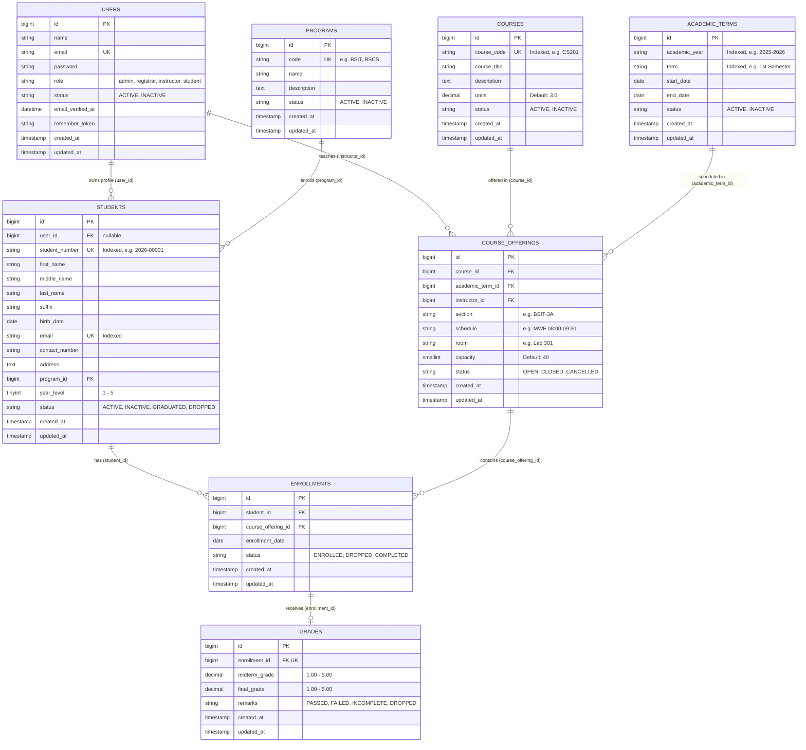

# Entity Relationship Diagram (ERD)

### Student Information Management System REST API

## Relational Constraints & Data Integrity

1. **Unique Constraints**:
   - `users.email` is unique.
   - `students.student_number` is unique.
   - `students.email` is unique.
   - `programs.code` is unique.
   - `courses.course_code` is unique.
   - `grades.enrollment_id` is unique (one-to-one relationship with enrollment).
   - **Composite Unique Index**: `enrollments(student_id, course_offering_id)` strictly prevents duplicate student enrollments in the same offering.

2. **Foreign Key Cascades**:
   - `students.program_id` cascades on delete.
   - `students.user_id` nulls on delete.
   - `course_offerings.course_id`, `academic_term_id`, `instructor_id` cascade on delete.
   - `enrollments.student_id`, `course_offering_id` cascade on delete.
   - `grades.enrollment_id` cascades on delete.
